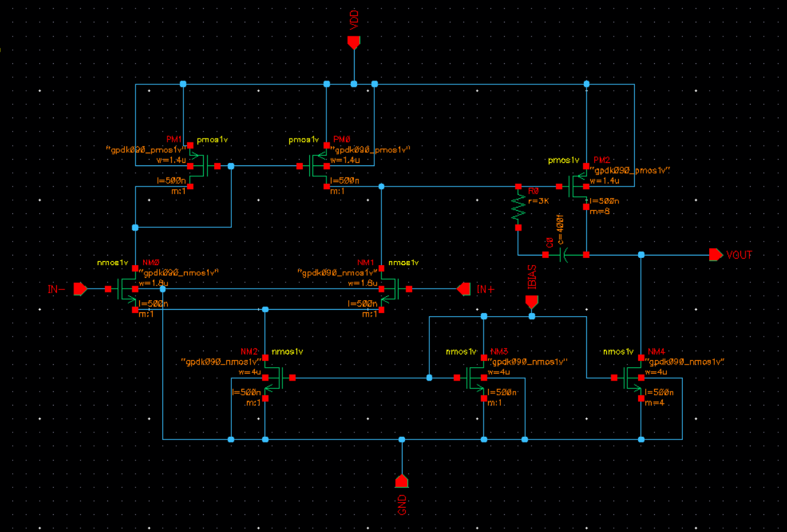
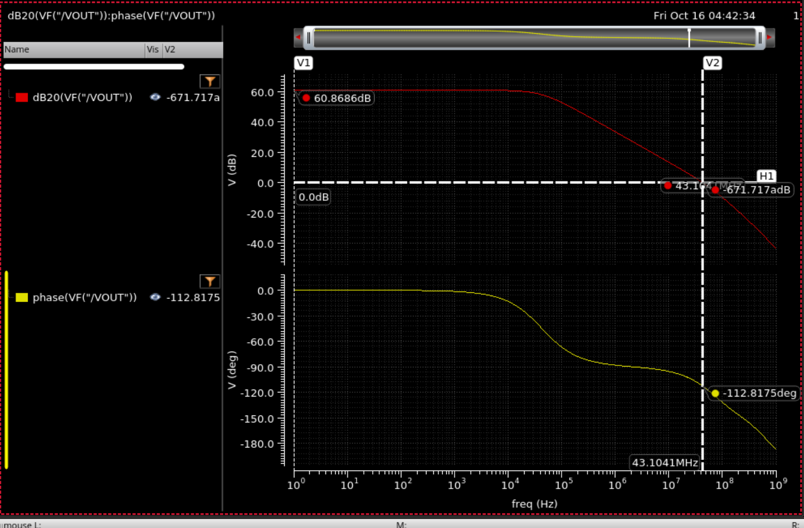
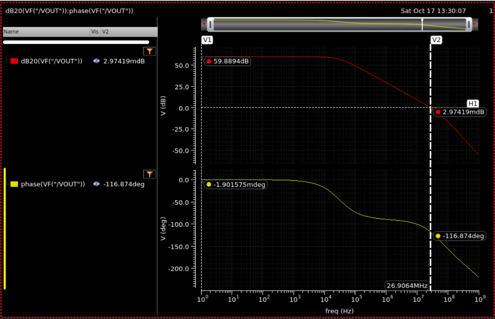
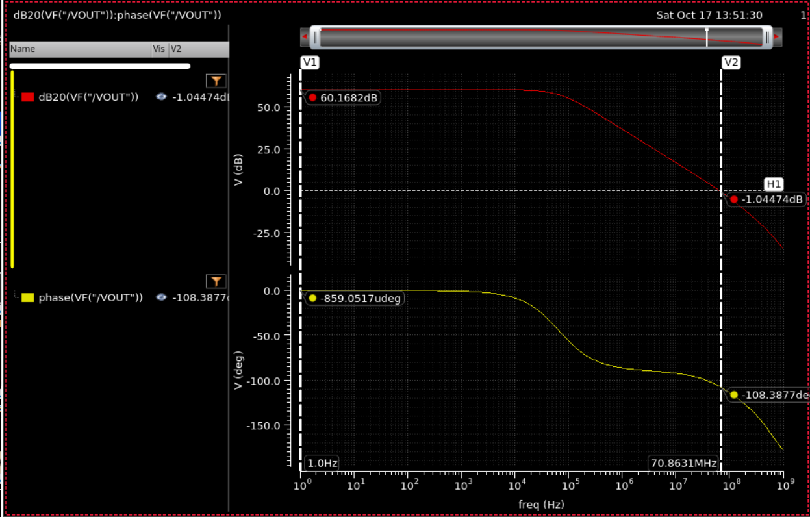
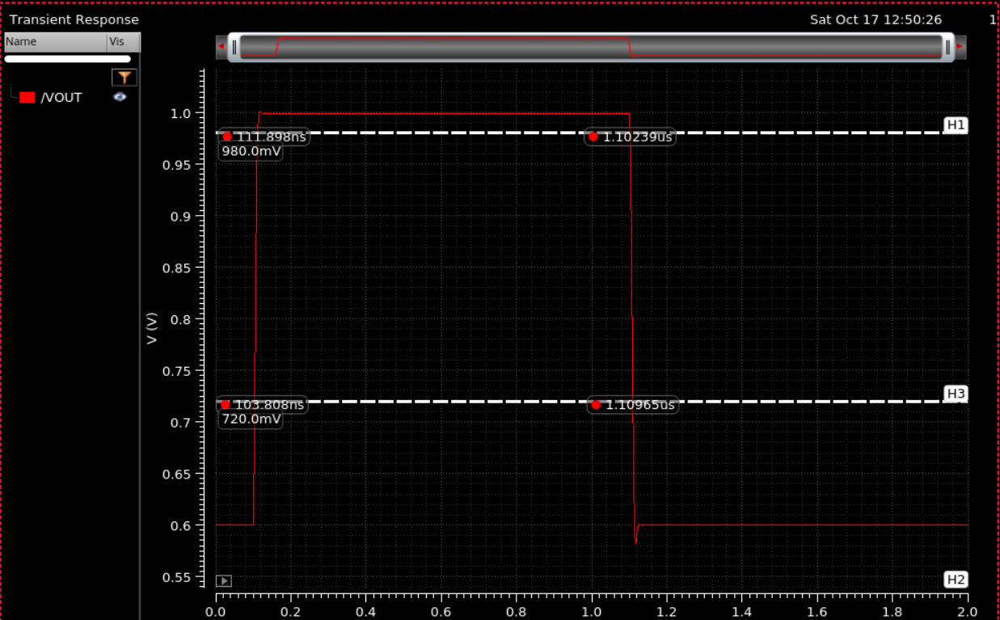
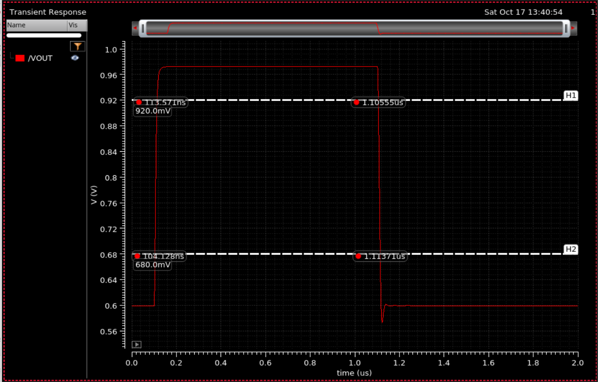
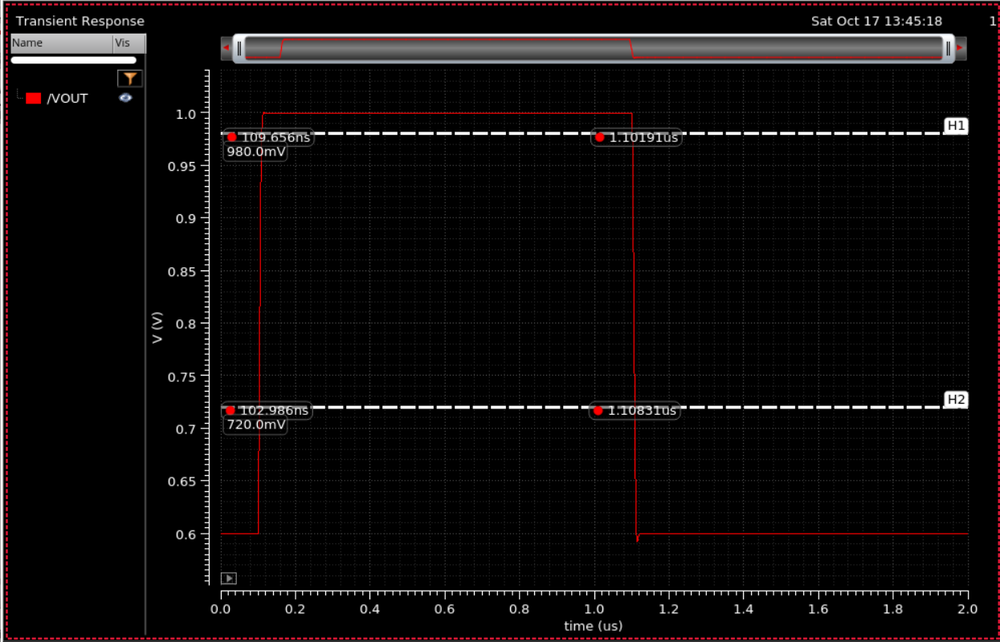

# Two-Stage-Miller-Compensated-CMOS-Op-Amp
Transistor-level design of a 1.2 V two-stage Miller-compensated operational amplifier in 90 nm CMOS (Cadence GPDK090). Devices are sized with the gm/ID methodology instead of square-law hand calculations, because of short-channel effects at this node. Designed and simulated in Cadence Virtuoso (ADE L, ADE XL, Spectre).

Course: <electronics and communication engineering, indian institute of information technology kottayam >
Name / Roll Number: <2025bec0006>

## Specifications and Results

All results below: NN corner, 27 °C, CL = 1 pF. Slew rate is measured with the op-amp in a unity-gain buffer configuration.

| Specification | Target | Achieved | Status |
|---|---|---|---|
| Technology / supply | GPDK090, 1.2 V | GPDK090, 1.2 V | Pass |
| Open-loop DC gain | ≥ 50 dB | 60.87 dB | Pass |
| Unity-gain bandwidth | ≥ 20 MHz | 43.10 MHz | Pass |
| Phase margin | ≥ 60° | 67.2° | Pass |
| Slew rate | ≥ 10 V/µs | ≈ 32 V/µs rising, ≈ 36 V/µs falling | Pass |
| Power dissipation | ≤ 1 mW | ≈ 0.14 mW (from design currents) | Pass |
| Load capacitance | 1 pF | 1 pF | Pass |

All three PVT corners (NN, SS, FF) also meet every specification. See [Corner Results](#corner-results).

---

## Architecture

| Block | Devices | Notes |
|---|---|---|
| Stage 1 | NM0, NM1 (NMOS diff pair), PM0, PM1 (PMOS mirror load), NM2 (NMOS tail) | Converts the differential input to a single-ended signal at node V1 |
| Stage 2 | PM2 (PMOS common-source), NM4 (NMOS current-source load) | Output at the PM2/NM4 drains |
| Bias | NM3 (diode-connected NMOS), 20 µA reference | NM2 = 1x NM3, NM4 = 4x NM3 |
| Compensation | Cc in series with Rz, from stage-1 output (V1) to the op-amp output | Rz moves the right-half-plane zero into the left half plane |

All devices use L = 500 nm.


*Two-stage Miller-compensated op-amp schematic.*

---

## Design Methodology

1. **Device characterization.** DC sweep of VGS for the NMOS and PMOS devices at several channel lengths, extracting gm/ID vs ID/W and gm/ID vs gm·ro.
2. **Choose L from the gain budget.** gm·ro grows strongly with L at a given gm/ID. A single stage at minimum length cannot reach the gain target with two stages, so L = 500 nm was used for every device.
3. **Size from the charts.** W = ID / (ID/W read at the chosen gm/ID and L). Mirror ratios fix the currents, and PM2 = 8x PM1 with NM4 = 4x NM3 balances the second stage at about 80 µA, which removes systematic offset.
4. **Compensate.** Cc sets the dominant pole and UGB (UGB = gm1 / 2πCc). Rz is chosen larger than 1/gm2 so the zero moves into the left half plane.
5. **Verify.** DC operating point (every device in saturation), AC (gain, UGB, phase margin), transient slew in a unity-gain buffer, then PVT corners in ADE XL.

---

## Final Design

All devices have L = 0.5 µm. Currents are the nominal design values set by the bias and mirror ratios.

| Device | Role | W | m | Nominal ID |
|---|---|---|---|---|
| NM0, NM1 | Input pair | 1.8 µm | 1 | ≈ 10 µA each |
| PM0, PM1 | Mirror load | 1.4 µm | 1 | ≈ 10 µA each |
| NM2 | Tail | 4 µm | 1 | ≈ 20 µA |
| NM3 | Bias diode | 4 µm | 1 | 20 µA |
| PM2 | 2nd-stage driver | 1.4 µm | 8 | ≈ 80 µA |
| NM4 | 2nd-stage load | 4 µm | 4 | ≈ 80 µA |

Cc = 400 fF, Rz = 3 kΩ, CL = 1 pF, IBIAS = 20 µA, input common mode = 750 mV.

Input common mode must keep the tail in saturation: VICM ≥ Vgs(pair) + Vdsat(NM2). At 0.7 V the tail fell into triode at 125 °C, so 750 mV is used.

---

## Results

### AC response (NN, 27 °C)


*Open-loop response at NN: DC gain 60.87 dB, UGB 43.10 MHz, phase at UGB −112.82°, so PM ≈ 67.2°.*


*Open-loop response at SS (125 °C): DC gain 59.89 dB, UGB 26.91 MHz, phase at UGB −116.9°, so PM ≈ 63°.*


*Open-loop response at FF (−40 °C): DC gain 60.17 dB, UGB 63.70 MHz, phase at UGB −106.8°, so PM ≈ 73°.*

### Transient slew rate (NN, 27 °C)



Unity-gain buffer, CL = 1 pF, output stepping 0.6 V to 1.0 V. Slew rate measured between the 720 mV and 980 mV points of the output.

| Edge | Δt | Slew rate |
|---|---|---|
| Rising | 8.09 ns | 32.1 V/µs |
| Falling | 7.26 ns | 35.8 V/µs |

The falling edge shows a small undershoot that settles back to 0.6 V.


*Unity-gain buffer step response at SS (125 °C): rise about 22.5 V/µs, fall about 29.4 V/µs.*


*Unity-gain buffer step response at FF (−40 °C): rise about 38.6 V/µs, fall about 40.6 V/µs.*

### Corner Results

| Corner | DC gain | UGB | Phase at UGB | PM | Slew rise / fall |
|---|---|---|---|---|---|
| NN, 27 °C | 60.87 dB | 43.10 MHz | −112.8° | ≈ 67° | ≈ 31.8 / 35.7 V/µs |
| SS, 125 °C | 59.89 dB | 26.91 MHz | −116.9° | ≈ 63° | ≈ 22.5 / 29.4 V/µs |
| FF, −40 °C | 60.17 dB | 63.70 MHz | −106.8° | ≈ 73° | ≈ 38.6 / 40.6 V/µs |

Corner slew rates come from the Calculator slew-rate function, so they differ slightly from the marker-based values above.

Operating point at the worst case (SS, 125 °C): NM2 in saturation (vds 310.5 mV, vdsat 210.4 mV) and NM4 in saturation (vds 416.9 mV, vdsat 210.8 mV).

### Design Iterations

| Step | Change | Outcome |
|---|---|---|
| Initial gm/ID sizing, L = 500 nm | Cc = 0.5 pF, Rz = 3 kΩ | NN: 64.8 dB, 20.77 MHz, PM ≈ 64° |
| SS, 125 °C check | None | UGB only 13.53 MHz, below spec (gm drops with mobility) |
| Revision 1 | IBIAS 20 µA, Cc = 0.4 pF, NM4 m = 4, PM2 m = 8 | NN UGB ≈ 37.7 MHz, but tail NM2 entered triode at 125 °C and gain fell to 42.7 dB |
| Revision 2 (final) | VICM 0.7 V to 0.75 V, widened diff pair and current sources | All devices in saturation, all corners pass |

An early AC run showed 97 MHz UGB and about −2° phase margin. This was traced to a wrong Cc value in the testbench and was corrected before the results above.

---

## Verification Status

| Item | Status |
|---|---|
| DC operating point | Done |
| AC (gain, UGB, phase margin) | Done |
| Transient slew rate | Done |
| PVT corners (NN 27 °C / SS 125 °C / FF −40 °C) | Done |
| CMRR and PSRR | Not covered |
| Layout, DRC/LVS, post-layout (PEX) | Not covered |

---

## Repository Structure

```
.
├── README.md
└── images/
    ├── schematic.png
    ├── ac_nn.png
    ├── ac_ss.png
    ├── ac_ff.png
    ├── tran_nn.png
    ├── tran_ss.png
    └── tran_ff.png
```

---

## Reproducing the Results

1. Create the op-amp cell with the topology above in a library with GPDK090.
2. Device sizes as in the Final Design table, all lengths 500n. Cc = 400f, Rz = 3k.
3. Bias: 20 µA ideal current source into NM3, VDD = 1.2 V.
4. Analyses:
   - AC: 1 Hz to 1 GHz, both inputs at 750 mV DC, 1 V AC magnitude on one input. Plot dB20 and phase of VOUT, and read UGB and phase margin at the 0 dB crossing.
   - Transient: unity-gain buffer, CL = 1 pF, 0 to 2 µs, output stepping 0.6 V to 1.0 V at about 100 ns.
   - Corners: run NN (27 °C), SS (125 °C) and FF (−40 °C) in ADE XL.
5. Measure slew rate between the 720 mV and 980 mV points of the output edge.

---

## Notes

- **PDK not included.** GPDK090 is Cadence's proprietary academic PDK. Only result plots are in this repo, and a licensed GPDK090 install is required to re-run the simulations.
- Power is estimated from the design currents (20 µA tail + 80 µA second stage + 20 µA bias branch, at 1.2 V).

---

- ## References

1. P. E. Allen and D. R. Holberg, *CMOS Analog Circuit Design*, Oxford University Press. Reference text for the two-stage op-amp topology, Miller compensation, pole splitting and the nulling resistor.
